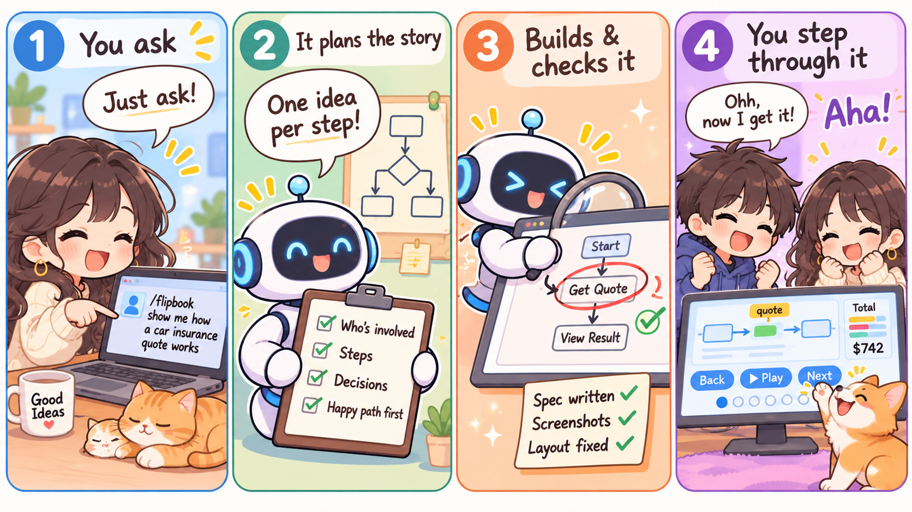

# flipbook - visually show me



Step-through, cartoon-style visualisations of concepts, processes and algorithms.
A visualisation is one **spec** file; the player renders it. No build step, no dependencies, fully local.

```
runtime/            the app — written once
  player.html/.css  page + the cartoon look
  core.js           shared helpers + scene-type registry
  types/*.js        one file per scene type (array, flow, card, waterfall, sequence, mindmap); header = its spec reference
  player.js         replays steps, renders, Back/Play/Next, scenarios
specs/*.js          one file per visualisation (sets window.VIZ)
tools/vsm.mjs       CLI: check (errors + screenshots), open, import, export
tools/import.mjs    Mermaid / PlantUML / outline → spec
docs/               README images, feature-map.md (planned features)
.claude/skills/     `visualize` (writes specs) and `reframe` (finds the right words first; by Lauren Tan, see Credits)
```

## Use

- Ask Claude: `/visualize show me how <thing> works` (skill at `.claude/skills/visualize`, picked up automatically when Claude Code runs in this repo).
- Open one: `node tools/vsm.mjs open motor-insurance-quote`
  (or `runtime/player.html?spec=<name>&scenario=N&step=N`)
- Check one: `node tools/vsm.mjs check <name> [--all]`
- Import one: `node tools/vsm.mjs import <file> [--name <spec>]` — Mermaid, PlantUML or a markdown
  outline (state machine, flow chart, sequence, mind map) becomes `specs/<spec>.js`. Captions are TODOs.
- Share one: `node tools/vsm.mjs export <name>` writes `dist/<name>.html`, a single file with the player
  and spec inside. It opens anywhere, with no other files (links to other levels need the full app).
- Keys: ← → step, space play/pause, Home/End.

## Examples

### Ask Claude

Type these in Claude Code's prompt box, in this repo. Claude plans the steps, picks the diagram (or
asks when two would fit), writes the spec, checks it in a real browser and opens it.

| You want… | Type |
|---|---|
| How a process works | `/visualize show me how a car insurance quote is made` |
| What state something is in | `/visualize the states of an online order, from cart to delivered` |
| Several levels of detail | `/visualize an online order in three levels: its states, the payment process, and the messages between shop, gateway and bank` |
| Who talks to whom | `/visualize the messages between a shop, a payment gateway and a bank when someone pays by card` |
| An algorithm | `/visualize binary search on a sorted list` |
| A mind map of one idea in a document | `/visualize a mind map of "levels" from docs/feature-map.md` |
| Your existing diagram, animated | `/visualize this:` then paste Mermaid or PlantUML text (it's read locally with `vsm import`) |
| The right words first | `/reframe <your idea>. Read <files>`, then `/visualize` the rewritten request (`/reframe` is included; see Credits) |

### Demos in `specs/`

Open any of them with `node tools/vsm.mjs open <name>`.

| Spec | Shows | Scene types |
|---|---|---|
| `binary-search` | An algorithm with a code panel and pointers | array |
| `motor-insurance-quote` | A process across five teams; a quote fills in; the price builds up; three scenarios | flow, card, waterfall |
| `order-state-machine` | Level 1: an order's states, with a self-loop and a retry loop. Click ⊕ on Paying to go down | flow, card |
| `take-payment` | Level 2: the work behind Paying. Click ⊕ on "Ask bank to approve" to go down | flow, card |
| `payment-messages` | Level 3: the messages behind one task; approved, confirm it's you, declined | sequence |
| `project-mindmap` | This project as a mind map: click an idea for its note, fold branches, cross-links | mindmap |
| `how-to-reframe` | How to use `/reframe`, step by step, with the command building up on a card | flow, card |
| `mindmap-stress` | A 265-idea map, to test size, zoom, folding and notes | mindmap |

## Requirements

- A browser (Chrome or Edge) — the player is plain HTML/CSS/JS, opened straight from disk.
- Node.js 18+ for the CLI only (no npm packages). Set `CHROME=/path/to/browser` if it isn't found.
- No Python today. If Python tooling is added, manage it with **uv** (`uv init`, `uv add`, `uv run`):
  commit `pyproject.toml`, `uv.lock` and `.python-version`; `.venv/` is ignored.

## Development

- Version control: git. `.gitignore` covers OS/editor clutter, `node_modules/`, Python/uv envs and
  caches, `.env*`, `.claude/settings.local.json`, and generated output (`snaps/`, `dist/`).
- `vsm check` writes screenshots to the system temp folder, never into the repo.
- Principles: first principles, DRY, SOLID, KISS — specs are data, the player never knows about
  specific scene types, shared code lives in `core.js`.

## Credits

- **`/reframe`** is by **Lauren Tan** ([@poteto](https://github.com/poteto)), part of her
  **pstack** skills, first published at
  [cursor/plugins/pstack](https://github.com/cursor/plugins/tree/main/pstack). The copy in
  `.claude/skills/reframe/` is unchanged and is used under the MIT licence
  (`.claude/skills/reframe/LICENSE`).

## Add a scene type

Create `runtime/types/<type>.js` that calls `VSM.register('<type>', { verbs, state, apply, View })`
(contract documented in `core.js`), document its scene fields and ops in the file header, and add a
`<script>` tag in `player.html`. The player itself never changes.
